# Flight frame

A colour E Ink frame for Raspberry Pi that shows the plane flying over your house right now: the route, airline, altitude and speed, with a drawing of that exact aircraft type and the airline's logo on its tail. The bottom line carries today's sunrise and sunset and a 12-hour weather forecast.

It's set up from your phone, with no app, no account and no subscription. The parts cost about £80.

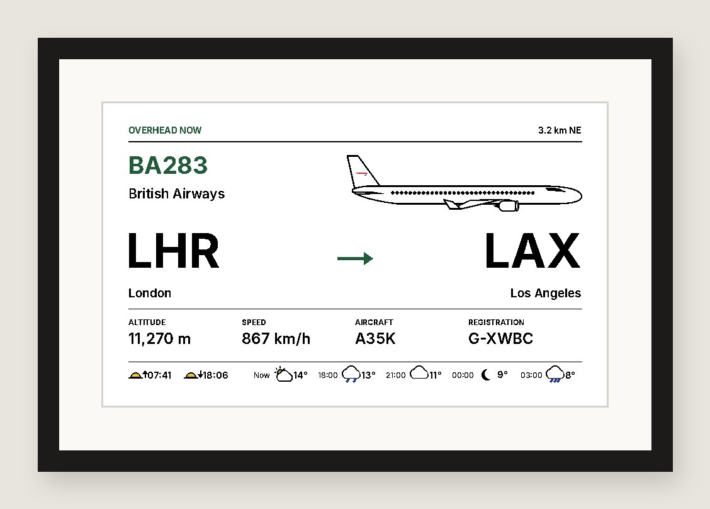

<sub>Mock-up using the exact image the frame draws. Photos of the real thing to follow.</sub>

## Contents

1. [What it shows](#what-it-shows)
2. [Parts](#parts)
3. [Assemble](#1-assemble)
4. [Flash the SD card (Mac)](#2-flash-the-sd-card-mac)
5. [First boot and SSH](#3-first-boot-and-ssh)
6. [Install](#4-install)
7. [Set your location](#5-set-your-location)
8. [Using it](#using-it)
9. [How it works](#how-it-works)
10. [Troubleshooting](#troubleshooting)
11. [Developing without a Pi](#developing-without-a-pi)
12. [Credits and data](#credits-and-data)

## What it shows

| | |
|---|---|
| 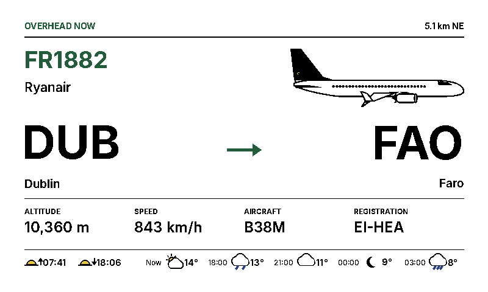 | 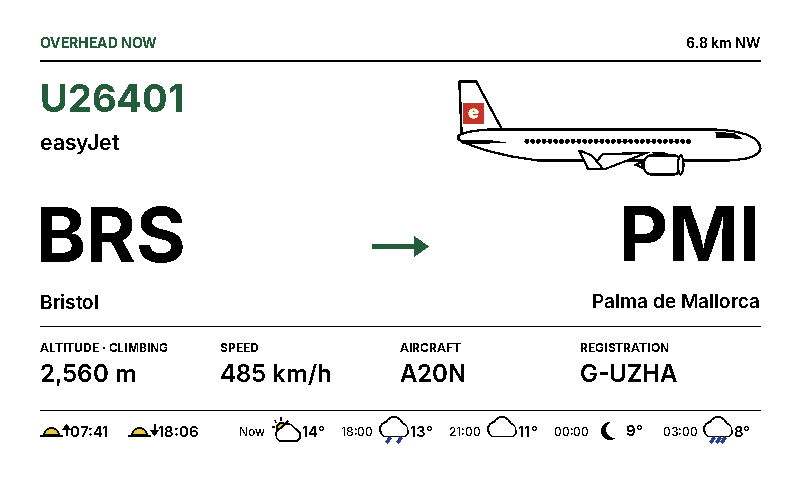 |
| A flight with a known route | Climbing out of Bristol |
| 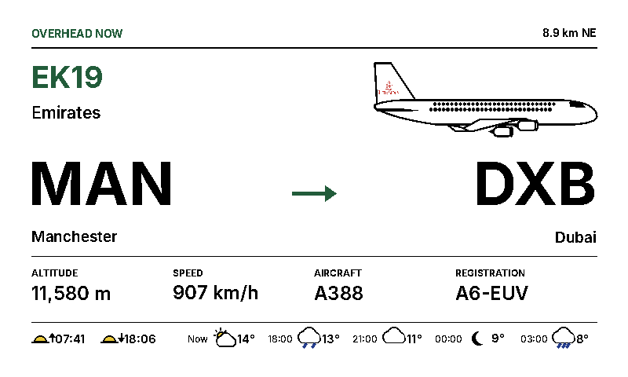 | 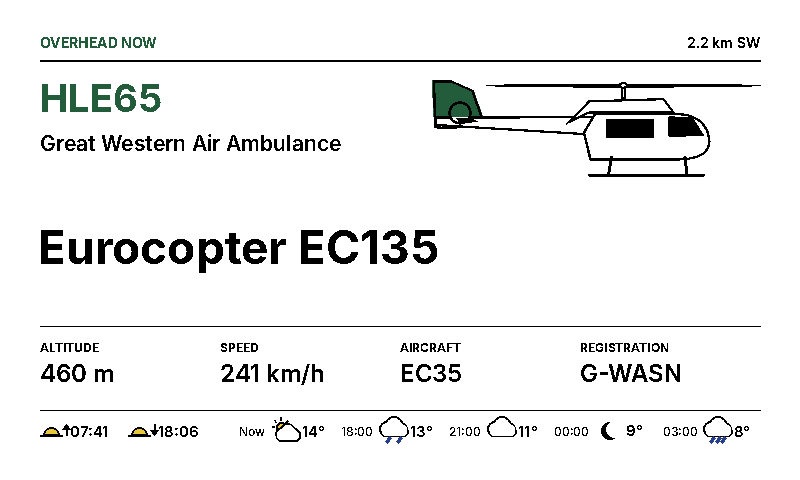 |
| An A380 at cruise | No published route, no logo: accent-coloured tail |
| 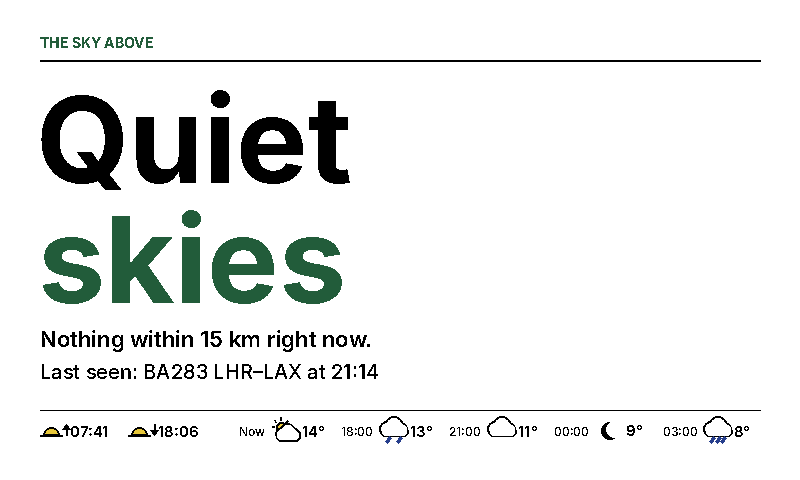 | 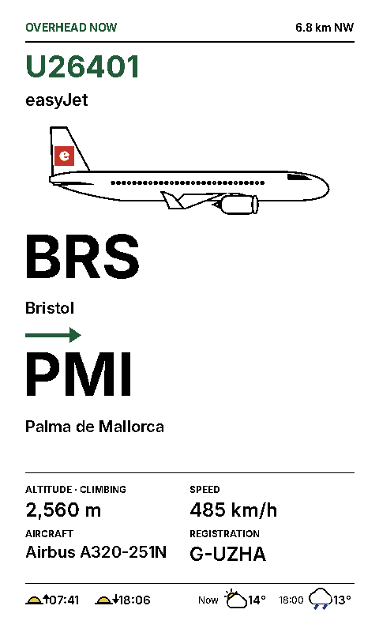 |
| Nothing in range | Portrait layout |

### Aircraft drawings

Each aircraft is drawn from its own measurements, so an A321neo is longer than an A319, a 737 MAX has split winglets, a 747 its hump and an A380 two decks. The archive covers **200+ types**, from airliners and business jets to helicopters, light aircraft, military types and hot air balloons. **[See every drawing](docs/airframes/README.md)**.


The frame downloads the latest archive from this repository once a day, so new types appear without reinstalling. The airline's logo is downloaded the first time that airline appears.

## Parts

| Part | Notes |
|---|---|
| [Pimoroni Inky Impression 7.3"](https://shop.pimoroni.com/products/inky-impression) (Spectra 6, PIM773) | 800×480, six colours. Arrives assembled, with standoffs and a 40-pin extension header. |
| [Raspberry Pi 3 A+](https://shop.pimoroni.com/products/raspberry-pi-3-a-plus) | Same footprint as the Inky, so it mounts flat on the back. A Zero 2 WH, Pi 4 or Pi 5 also work. |
| Power supply, 5V 2.5A **micro-USB** | The 3 A+ uses micro-USB, not USB-C. The official Raspberry Pi supply is safest. |
| microSD card, 8GB or more | |
| A frame | Pimoroni say the Inky fits a 180 × 130 mm IKEA frame (not perfectly centred). The visible screen is 160 × 96 mm. |

The **Waveshare 7.3" e-Paper HAT (E)** also works. Install with `sudo PANEL=waveshare ./install.sh` instead.

You'll also need a Mac (or any computer) with an SD card reader, and a 2.4 or 5GHz Wi-Fi network.

## 1. Assemble

Do this with the power unplugged.

1. Lay the Inky screen-down on something soft.
2. Screw the supplied standoffs into the four holes on the back of the Inky that line up with the Pi's corner holes.
3. Line the Pi's 40 pins up with the socket on the back of the Inky, with the Pi's components facing the Inky. Check the pins are square, not shifted one along, then press firmly until the Pi sits on the standoffs. If the standoffs stop the pins reaching, fit the extension header between the boards.
4. Screw the Pi down onto the standoffs.

The SD card slot ends up facing outwards, so you can flash the card before or after assembling.

## 2. Flash the SD card (Mac)

1. Install [Raspberry Pi Imager](https://www.raspberrypi.com/software/) and open it.
2. Put the microSD card in the Mac.
3. Work through the screens:
   - **Device:** Raspberry Pi 3 (or whichever Pi you have)
   - **Operating system:** Raspberry Pi OS (other) → **Raspberry Pi OS Lite (64-bit)**
   - **Storage:** the SD card. Check it isn't another drive.
4. On **Configure your system**:
   - **Hostname:** `flightframe`
   - **Location:** your time zone and keyboard
   - **User:** a username and password. **Note: Imager pre-fills your Mac's username here.** Change it to something you'll remember, such as `flightframe`, and note it down.
   - **Wireless LAN:** your Wi-Fi name, password and country
   - **Remote access:** turn **SSH on**. "Public key" is easiest if you have a key in `~/.ssh`. Otherwise use password.
   - Skip Raspberry Pi Connect and interface options. The installer switches on what it needs.
5. **Write**, enter your Mac password when asked, and eject the card when it's done.

## 3. First boot and SSH

1. Put the card in the Pi and plug in the power. The screen won't change yet, because nothing is driving it.
2. **Wait 5 to 10 minutes.** On first boot the Pi expands the card, applies your settings and restarts, sometimes twice. SSH only starts near the end.
3. Check it's ready from Terminal on the Mac:
   ```bash
   nc -vz flightframe.local 22
   ```
   Wait until it says `succeeded`.
4. Log in, using the username you set in Imager:
   ```bash
   ssh flightframe@flightframe.local
   ```
   Type `yes` to the fingerprint question the first time.

| You see | It means |
|---|---|
| `Connection refused` | The Pi is up but SSH hasn't started yet. Wait a few more minutes. If it persists after 10 minutes, see [Troubleshooting](#troubleshooting). |
| `Permission denied (publickey)` | Wrong username (often your Mac username, pre-filled by Imager), or the Mac isn't offering the key Imager used. Try `ssh -i ~/.ssh/YOUR_KEY user@flightframe.local`. |
| `Could not resolve hostname` | The Pi isn't on the network yet, or you mistyped the Wi-Fi details. Check your router for a new device and use its IP address. |

## 4. Install

On the Pi:

```bash
sudo apt install -y git
git clone https://github.com/stirtingale/flightframe.git
cd flightframe && sudo ./install.sh
sudo reboot
```

<details>
<summary>If the repository is private, copy it from your Mac instead</summary>

On the Mac, with the repository cloned or downloaded:

```bash
scp -r flightframe flightframe@flightframe.local:~
ssh flightframe@flightframe.local
cd flightframe && sudo ./install.sh
sudo reboot
```
</details>

The installer takes **10 to 15 minutes** on a Pi 3 A+ and will look stuck at times. It:

- installs the system packages
- switches on SPI and I2C, and adds `dtoverlay=spi0-0cs` to `/boot/firmware/config.txt`, which Pimoroni require for the Inky
- creates a Python environment in `/opt/flightframe/venv` and installs Pimoroni's [`inky`](https://github.com/pimoroni/inky) library
- copies the app to `/opt/flightframe`, with settings in `/var/lib/flightframe`
- sets up the setup hotspot and the `flightframe.local` name
- installs and enables the `flightframe` systemd service

## 5. Set your location

About two minutes after the reboot, the Inky refreshes for the first time. It takes around 30 seconds and flashes several colours. Then you'll see one of these:

| | |
|---|---|
| 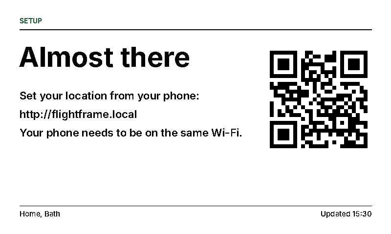 | 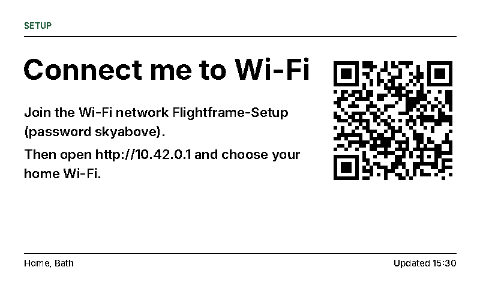 |
| **Almost there.** It's online. Open **http://flightframe.local** on your phone (same Wi-Fi), search your address or postcode and press **Save**. | **Connect me to Wi-Fi.** It couldn't get online. Scan the QR code or join `Flightframe-Setup` (password `skyabove`), and the setup page should open. If not, go to `http://10.42.0.1`. Pick your Wi-Fi. |

The first flight appears within a minute or so of saving.

## Using it

### Buttons (Inky only)

| Button | Does |
|---|---|
| A (top) | Refresh now |
| B, C | Spare |
| D (bottom) | Show the settings address with a QR code. Press A to go back. |

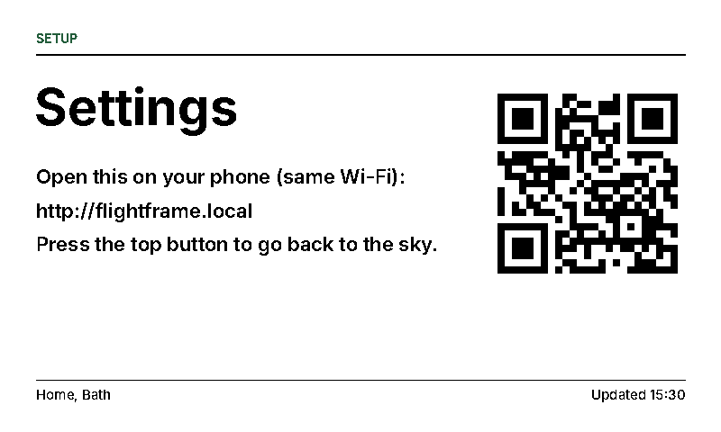

### Settings page

Open **http://flightframe.local** on any device on the same Wi-Fi.

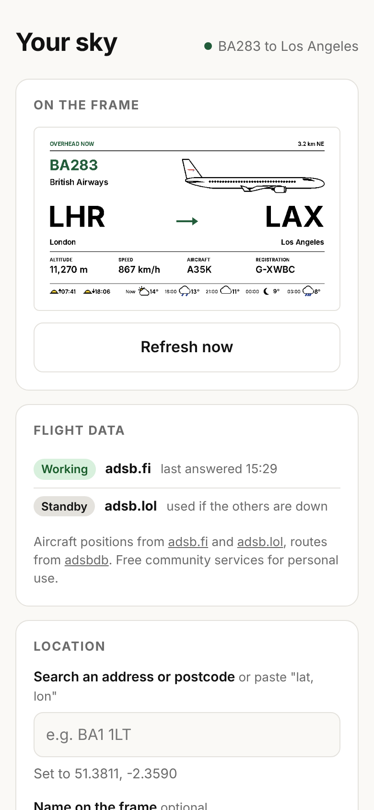

You can set:

- **Location:** an address, postcode or pasted `lat, lon`, plus the name shown in the footer
- **Range:** how far out counts as overhead, and an altitude ceiling
- **Look:** metric or imperial, landscape or portrait, normal or upside down, aircraft drawing on or off, 12-hour forecast or sun times only, accent colour (green by default, which looks British racing green on the paper)
- **Refresh:** the minimum gap before a new flight is drawn, how often height and speed update, and quiet hours

The page also shows a live preview of what's on the paper.

## How it works

- Every 30 seconds it asks [adsb.fi](https://adsb.fi) for aircraft near you, then looks up the airline, route and aircraft on [adsbdb](https://www.adsbdb.com). If adsb.fi is down it falls back to [adsb.lol](https://adsb.lol), which allows only 500 requests a day per connection, so it's kept for emergencies.
- Each source is treated politely. A "slow down" reply (HTTP 429) pauses that source for exactly as long as it asks, a refusal pauses it for 6 hours, and timeouts back off from 30 seconds up to 5 minutes. While nothing answers, the frame polls less often. The settings page shows each source's status.
- It picks the nearest aircraft within range, measured on the slant, so a jet directly overhead beats a light aircraft a few miles off. If a flight with a known route is nearly as close, it prefers that one.
- Colour E Ink takes about 30 seconds per refresh and shouldn't refresh more often than every 3 minutes. So the paper only redraws when a **different** flight is overhead, or every 10 minutes to update height and speed. With no power, it keeps its last picture.
- Everything is drawn in the panel's six exact colours with no anti-aliasing, so text stays crisp and nothing gets dithered.
- **Aircraft drawings** are built from each type's dimensions in [`flightframe/data/airframes.json`](flightframe/data/airframes.json) (generated from [`tools/build_airframes.py`](tools/build_airframes.py)). Unknown type codes use the closest match (a `B739ER` draws as a `B739`), then the broadcast category. The archive is refreshed from GitHub once a day, and a copy ships with the app.
- **Weather** comes from [MET Norway](https://api.met.no) (falling back to [Open-Meteo](https://open-meteo.com)), cached for 30 minutes and kept for up to 6 hours if both are down. Sunrise and sunset are calculated on the Pi, so they always show.
- **Airline logos** come from the [airline-logos](https://github.com/Jxck-S/airline-logos) collection (with Kiwi.com's icons as a fallback). They're cached in `/var/lib/flightframe/logos` and fitted inside the tail fin. A logo that's all yellow gets a black fin so it stays visible. With no logo, the fin takes the accent colour. To use your own image, drop a PNG named after the airline's ICAO code (e.g. `BAW.png`) into that folder.
- **Outages don't take over the screen.** For the first 45 minutes without data, the last picture stays up. After that, a calm "Waiting for flight data" screen appears, and the sky returns as soon as data does.
- The setup hotspot only opens if the Wi-Fi connection itself is lost for 30 minutes (not just the internet or a data service). While in setup mode, it tries your saved Wi-Fi every 10 minutes and rejoins by itself.

## Troubleshooting

**See what it's doing:**

```bash
journalctl -u flightframe -f
```

| Problem | Try |
|---|---|
| SSH still refused after 10 minutes | Unplug the Pi, put the card in the Mac, run `touch /Volumes/bootfs/ssh && diskutil eject /Volumes/bootfs`, then boot again. Or re-flash with SSH switched on. |
| Logs say no Inky was detected | Reseat the board, check you rebooted after installing, and check `dtoverlay=spi0-0cs` is in `/boot/firmware/config.txt`. |
| Can't open flightframe.local | Your phone must be on the same Wi-Fi. Press button D for the QR code, or use the Pi's IP address from your router. |
| Picture is upside down | Settings page → **Mounted: upside down**. |
| Wrong or missing route | Route data comes from a community database and is sometimes missing or out of date. When there is no route, the frame shows the aircraft type instead. |
| "Waiting for flight data" (below) | No source has answered for 45 minutes. Open the settings page to see each source's status. If adsb.fi shows "refused", the service may have changed its terms: check [adsb.fi](https://adsb.fi). |
| Very few flights | Increase the range on the settings page. Near airports and flight paths you'll see far more. |

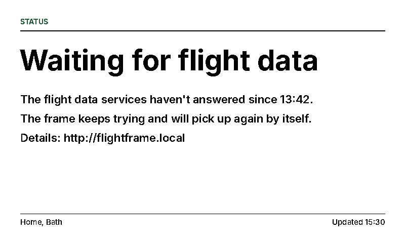

**Updating:**

```bash
cd ~/flightframe && git pull && sudo ./install.sh
```

If you installed by copying the folder rather than with `git clone`, switch to a clone once:

```bash
cd ~ && git clone https://github.com/stirtingale/flightframe.git && cd flightframe && sudo ./install.sh
```

Your settings and cached logos live in `/var/lib/flightframe`, so they survive updates.

**Settings file:** `/var/lib/flightframe/config.json`

## Developing without a Pi

```bash
pip install pillow flask requests qrcode numpy
python3 tools/preview.py previews        # every screen as PNGs
python3 tools/build_airframes.py         # rebuild the archive after editing it
python3 tools/airframe_sheets.py         # redraw the catalogue in docs/airframes
FRAME_STATE_DIR=./state python3 -m flightframe --port 8080 --display preview
```

Then open http://localhost:8080 and set a location. The current screen is written to `state/screen.png`.

### Layout

```
flightframe/
  app.py       main loop: when to poll and when the paper is worth refreshing
  flights.py   ADS-B feeds, nearest-aircraft choice, route and aircraft lookup
  render.py    the screens, drawn in the panel's exact six colours
  plane.py     renders aircraft drawings, with the logo fitted into the tail fin
  airframes.py builds each type's drawing from its dimensions; daily archive refresh
  data/airframes.json  the aircraft archive (200+ types)
  weather.py   12-hour forecast and sunrise/sunset
  logos.py     airline logo download and cache
  display.py   Inky or Waveshare panel, or PNG preview on a normal computer
  buttons.py   Inky side buttons
  web.py       phone settings page
  wifi.py      setup hotspot through NetworkManager
install.sh     one-shot installer (PANEL=inky by default, or PANEL=waveshare)
systemd/       service definition
tools/         preview renderer, airframe archive builder, catalogue and README image generators
docs/images/   README images
```

## Credits and data

- Aircraft positions: [adsb.fi](https://adsb.fi) (primary) and [adsb.lol](https://adsb.lol) (fallback), community ADS-B networks. Both are free for **personal, non-commercial use**, and adsb.fi asks to be credited, as it is here and on the settings page. If you have a receiver, consider [feeding adsb.fi](https://adsb.fi): feeders also get higher limits.
- Routes and aircraft: [adsbdb](https://www.adsbdb.com).
- Weather: [MET Norway](https://api.met.no) (CC BY 4.0) and [Open-Meteo](https://open-meteo.com) (CC BY 4.0).
- Aircraft drawings: original line drawings generated from approximate published dimensions.
- Airline logos: [Jxck-S/airline-logos](https://github.com/Jxck-S/airline-logos) and Kiwi.com. Logos remain their airlines' trademarks. They're downloaded at run time for display on your own frame and are not included in this repository.
- Panel driver: Pimoroni's [inky](https://github.com/pimoroni/inky) library.
- Inspired by the [Avioframe](https://avioframe.com). This is an independent project, not affiliated with it.

The service runs as root because it needs the GPIO and SPI pins, port 80 and Wi-Fi control. It's meant for your home network: don't expose it to the internet.
