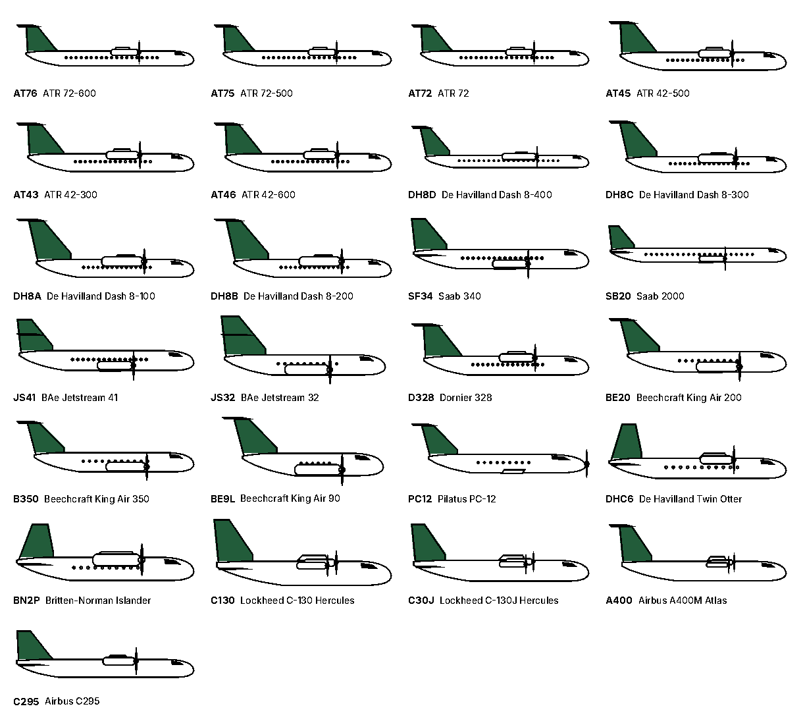
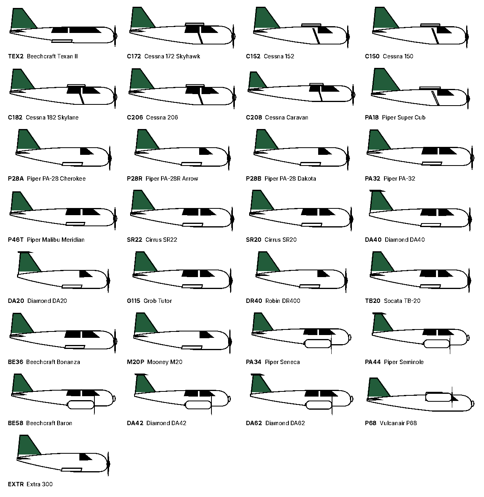
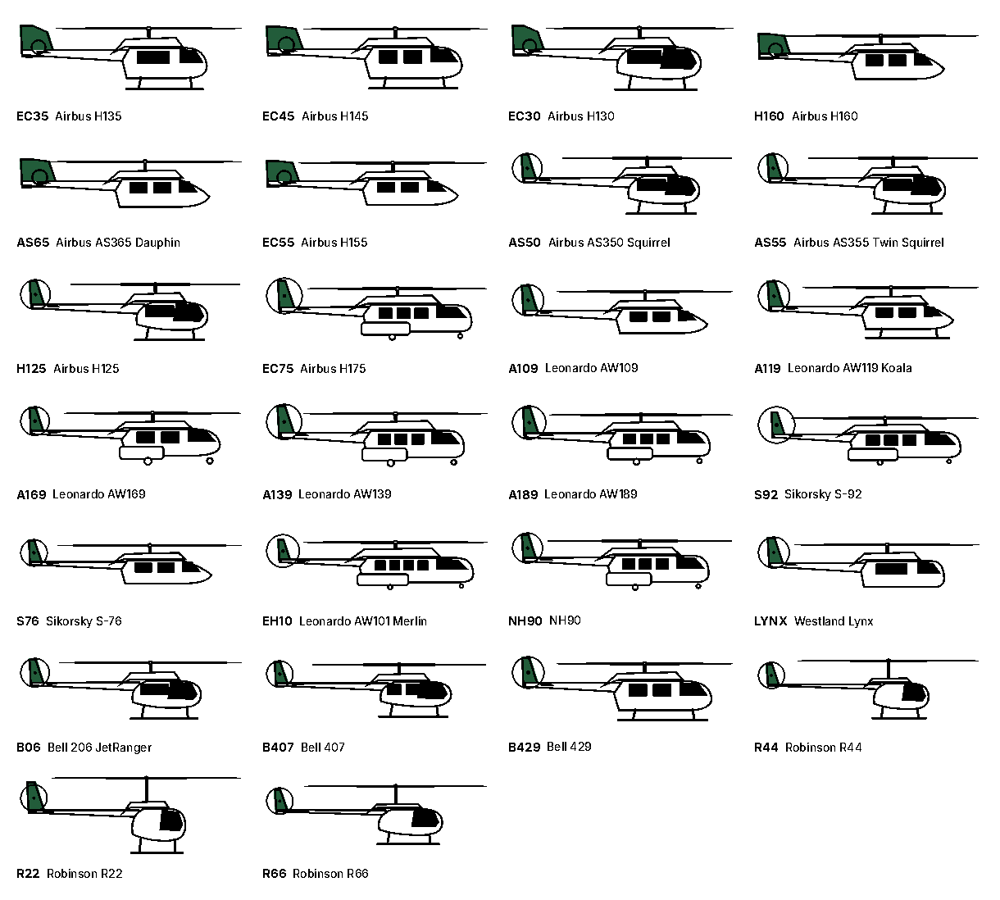
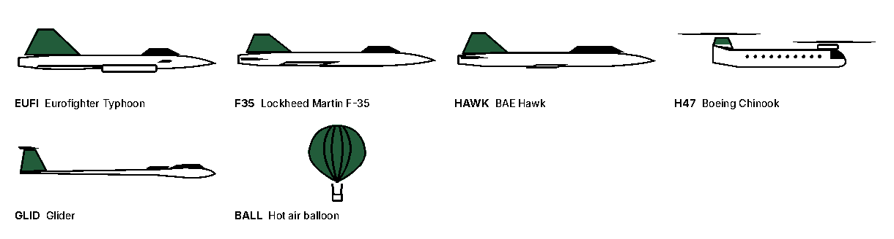

# Aircraft drawings

Every type the frame can draw: 202 in total. Each is built from approximate dimensions in [`flightframe/data/airframes.json`](../../flightframe/data/airframes.json), generated from [`tools/build_airframes.py`](../../tools/build_airframes.py).

The frame downloads the latest archive from this repository once a day, so new types appear without reinstalling. Unknown types fall back to the closest code, then to the broadcast category.

To add a type, add a line to `tools/build_airframes.py` (often just `like=` an existing type with a different length), run it, then run `tools/airframe_sheets.py` and commit.

## Jets (116)

| Code | Aircraft |
|---|---|
| `A320` | Airbus A320 |
| `A319` | Airbus A319 |
| `A318` | Airbus A318 |
| `A321` | Airbus A321 |
| `A20N` | Airbus A320neo |
| `A19N` | Airbus A319neo |
| `A21N` | Airbus A321neo |
| `BCS3` | Airbus A220-300 |
| `BCS1` | Airbus A220-100 |
| `A332` | Airbus A330-200 |
| `A333` | Airbus A330-300 |
| `A338` | Airbus A330-800neo |
| `A339` | Airbus A330-900neo |
| `A342` | Airbus A340-200 |
| `A343` | Airbus A340-300 |
| `A345` | Airbus A340-500 |
| `A346` | Airbus A340-600 |
| `A359` | Airbus A350-900 |
| `A35K` | Airbus A350-1000 |
| `A388` | Airbus A380-800 |
| `A306` | Airbus A300-600 |
| `A310` | Airbus A310 |
| `A3ST` | Airbus Beluga |
| `B738` | Boeing 737-800 |
| `B737` | Boeing 737-700 |
| `B736` | Boeing 737-600 |
| `B739` | Boeing 737-900 |
| `B734` | Boeing 737-400 |
| `B733` | Boeing 737-300 |
| `B735` | Boeing 737-500 |
| `B38M` | Boeing 737 MAX 8 |
| `B37M` | Boeing 737 MAX 7 |
| `B39M` | Boeing 737 MAX 9 |
| `B3XM` | Boeing 737 MAX 10 |
| `P8` | Boeing P-8 Poseidon |
| `B752` | Boeing 757-200 |
| `B753` | Boeing 757-300 |
| `B762` | Boeing 767-200 |
| `B763` | Boeing 767-300 |
| `B764` | Boeing 767-400 |
| `B772` | Boeing 777-200 |
| `B77L` | Boeing 777-200LR |
| `B773` | Boeing 777-300 |
| `B77W` | Boeing 777-300ER |
| `B778` | Boeing 777-8 |
| `B779` | Boeing 777-9 |
| `B788` | Boeing 787-8 |
| `B789` | Boeing 787-9 |
| `B78X` | Boeing 787-10 |
| `B744` | Boeing 747-400 |
| `B748` | Boeing 747-8 |
| `MD11` | McDonnell Douglas MD-11 |
| `B712` | Boeing 717 |
| `E190` | Embraer E190 |
| `E195` | Embraer E195 |
| `E170` | Embraer E170 |
| `E75L` | Embraer E175 |
| `E75S` | Embraer E175 |
| `E290` | Embraer E190-E2 |
| `E295` | Embraer E195-E2 |
| `E145` | Embraer ERJ-145 |
| `E135` | Embraer ERJ-135 |
| `E35L` | Embraer Legacy 600 |
| `CRJ2` | Bombardier CRJ200 |
| `CRJ7` | Bombardier CRJ700 |
| `CRJ9` | Bombardier CRJ900 |
| `CRJX` | Bombardier CRJ1000 |
| `SU95` | Sukhoi Superjet 100 |
| `C919` | COMAC C919 |
| `B461` | BAe 146-100 |
| `RJ85` | Avro RJ85 |
| `C68A` | Cessna Citation Latitude |
| `C700` | Cessna Citation Longitude |
| `C680` | Cessna Citation Sovereign |
| `C56X` | Cessna Citation Excel |
| `C560` | Cessna Citation V |
| `C25A` | Cessna Citation CJ2 |
| `C25B` | Cessna Citation CJ3 |
| `C25C` | Cessna Citation CJ4 |
| `C525` | Cessna CitationJet |
| `C510` | Cessna Citation Mustang |
| `C750` | Cessna Citation X |
| `CL35` | Bombardier Challenger 350 |
| `CL30` | Bombardier Challenger 300 |
| `CL60` | Bombardier Challenger 650 |
| `GLEX` | Bombardier Global Express |
| `GL5T` | Bombardier Global 5000 |
| `GL6T` | Bombardier Global 6500 |
| `GL7T` | Bombardier Global 7500 |
| `GLF4` | Gulfstream IV |
| `GLF5` | Gulfstream V |
| `GLF6` | Gulfstream G650 |
| `GA6C` | Gulfstream G600 |
| `GA7C` | Gulfstream G700 |
| `G280` | Gulfstream G280 |
| `FA7X` | Dassault Falcon 7X |
| `FA8X` | Dassault Falcon 8X |
| `F900` | Dassault Falcon 900 |
| `FA50` | Dassault Falcon 50 |
| `F2TH` | Dassault Falcon 2000 |
| `FA6X` | Dassault Falcon 6X |
| `LJ45` | Learjet 45 |
| `LJ75` | Learjet 75 |
| `LJ35` | Learjet 35 |
| `PC24` | Pilatus PC-24 |
| `E55P` | Embraer Phenom 300 |
| `E50P` | Embraer Phenom 100 |
| `E545` | Embraer Praetor 500 |
| `E550` | Embraer Praetor 600 |
| `H25B` | Hawker 800 |
| `HDJT` | HondaJet |
| `C17` | Boeing C-17 Globemaster |
| `K35R` | Boeing KC-135 Stratotanker |
| `E3TF` | Boeing E-3 Sentry |
| `E3CF` | Boeing E-3 Sentry |
| `E737` | Boeing E-7 Wedgetail |

## Turboprops (25)

| Code | Aircraft |
|---|---|
| `AT76` | ATR 72-600 |
| `AT75` | ATR 72-500 |
| `AT72` | ATR 72 |
| `AT45` | ATR 42-500 |
| `AT43` | ATR 42-300 |
| `AT46` | ATR 42-600 |
| `DH8D` | De Havilland Dash 8-400 |
| `DH8C` | De Havilland Dash 8-300 |
| `DH8A` | De Havilland Dash 8-100 |
| `DH8B` | De Havilland Dash 8-200 |
| `SF34` | Saab 340 |
| `SB20` | Saab 2000 |
| `JS41` | BAe Jetstream 41 |
| `JS32` | BAe Jetstream 32 |
| `D328` | Dornier 328 |
| `BE20` | Beechcraft King Air 200 |
| `B350` | Beechcraft King Air 350 |
| `BE9L` | Beechcraft King Air 90 |
| `PC12` | Pilatus PC-12 |
| `DHC6` | De Havilland Twin Otter |
| `BN2P` | Britten-Norman Islander |
| `C130` | Lockheed C-130 Hercules |
| `C30J` | Lockheed C-130J Hercules |
| `A400` | Airbus A400M Atlas |
| `C295` | Airbus C295 |

## Light aircraft (29)

| Code | Aircraft |
|---|---|
| `TEX2` | Beechcraft Texan II |
| `C172` | Cessna 172 Skyhawk |
| `C152` | Cessna 152 |
| `C150` | Cessna 150 |
| `C182` | Cessna 182 Skylane |
| `C206` | Cessna 206 |
| `C208` | Cessna Caravan |
| `PA18` | Piper Super Cub |
| `P28A` | Piper PA-28 Cherokee |
| `P28R` | Piper PA-28R Arrow |
| `P28B` | Piper PA-28 Dakota |
| `PA32` | Piper PA-32 |
| `P46T` | Piper Malibu Meridian |
| `SR22` | Cirrus SR22 |
| `SR20` | Cirrus SR20 |
| `DA40` | Diamond DA40 |
| `DA20` | Diamond DA20 |
| `G115` | Grob Tutor |
| `DR40` | Robin DR400 |
| `TB20` | Socata TB-20 |
| `BE36` | Beechcraft Bonanza |
| `M20P` | Mooney M20 |
| `PA34` | Piper Seneca |
| `PA44` | Piper Seminole |
| `BE58` | Beechcraft Baron |
| `DA42` | Diamond DA42 |
| `DA62` | Diamond DA62 |
| `P68` | Vulcanair P68 |
| `EXTR` | Extra 300 |

## Helicopters (26)

| Code | Aircraft |
|---|---|
| `EC35` | Airbus H135 |
| `EC45` | Airbus H145 |
| `EC30` | Airbus H130 |
| `H160` | Airbus H160 |
| `AS65` | Airbus AS365 Dauphin |
| `EC55` | Airbus H155 |
| `AS50` | Airbus AS350 Squirrel |
| `AS55` | Airbus AS355 Twin Squirrel |
| `H125` | Airbus H125 |
| `EC75` | Airbus H175 |
| `A109` | Leonardo AW109 |
| `A119` | Leonardo AW119 Koala |
| `A169` | Leonardo AW169 |
| `A139` | Leonardo AW139 |
| `A189` | Leonardo AW189 |
| `S92` | Sikorsky S-92 |
| `S76` | Sikorsky S-76 |
| `EH10` | Leonardo AW101 Merlin |
| `NH90` | NH90 |
| `LYNX` | Westland Lynx |
| `B06` | Bell 206 JetRanger |
| `B407` | Bell 407 |
| `B429` | Bell 429 |
| `R44` | Robinson R44 |
| `R22` | Robinson R22 |
| `R66` | Robinson R66 |

## Military, gliders and balloons (6)

| Code | Aircraft |
|---|---|
| `EUFI` | Eurofighter Typhoon |
| `F35` | Lockheed Martin F-35 |
| `HAWK` | BAE Hawk |
| `H47` | Boeing Chinook |
| `GLID` | Glider |
| `BALL` | Hot air balloon |
